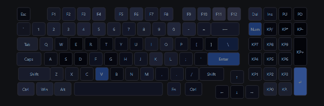
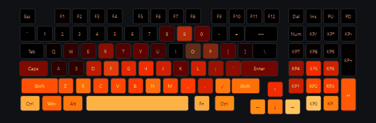
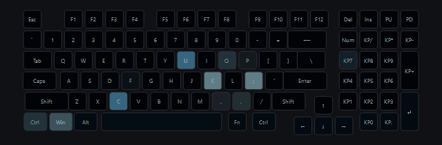
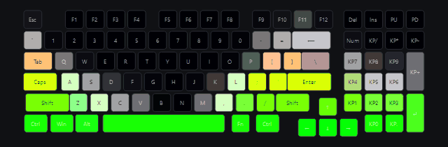
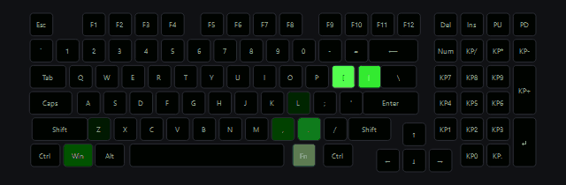
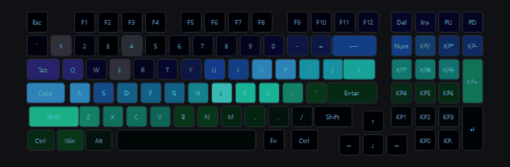

# ARDOR RGB

**Live lighting for the ARDOR GAMING Guardian keyboard.** A thunderstorm whose lightning strikes the key you press, fire that flares up as you type, an equalizer for any audio playing on your PC, CPU-load and volume indicators right on the keys.

[Русская версия](README.md) · [USB protocol](docs/PROTOCOL.en.md)

> The app UI and the detailed docs (architecture, effects, contributing) are in Russian. This page and the protocol description are in English.

| Storm | Fire | Rain |
|---|---|---|
|  |  |  |
| **Equalizer** | **Matrix** | **Aurora** |
|  |  |  |

<sub>Previews rendered by the app itself, not filmed. Key presses and music in them are synthetic.</sub>

## What it is

The stock Guardian app only switches between the lighting modes built into the keyboard's firmware. ARDOR RGB renders every frame on the PC instead — 60 times per second — and streams it to the keyboard, so an effect can be anything: a fire simulation, procedural clouds, a reaction to sound, to key presses or to the system state.

## Features

- **16 effects**: Storm, Rain, Fire, Equalizer, Bass Pulse, Matrix, Aurora, Ocean / Lava, plus classics (rainbow wave, plasma, ripples, typing flashes, stars, breathing).
- **Key-press reactions**: lightning strikes the pressed key, sparks fly out of it, rain splashes from it.
- **System audio**: music effects listen to whatever plays on the default output device (WASAPI loopback). No microphone needed.
- **Overlays on top of any effect**: CPU load on F1–F12, a volume bar on the number row that pops up when the volume changes.
- **Per-effect settings** with sliders, live keyboard preview, settings are saved.
- **Smart modes**: no key reactions while a fullscreen game is running, slow breathing on the lock screen, lights off while the PC sleeps.
- **Global hotkeys**, tray icon, start with Windows.
- **Safe exit**: the keyboard's own lighting mode is restored when the app closes. Reconnects automatically if the cable is pulled.

## Compatibility

| Keyboard | USB VID:PID | Connection | Status |
|---|---|---|---|
| ARDOR GAMING Guardian (95%) | `320F:5055` | wired | ✅ tested |
| Other Telink / EVision `320F:5055` boards | `320F:5055` | wired | ❓ protocol likely the same, LED map will differ |

Windows 10 / 11 only. Wired connection only (wireless was not tested). For another model, the LED map can be captured with `tools/probe.py` — see [CONTRIBUTING](docs/CONTRIBUTING.md) (in Russian) or open an issue.

## Install

Python 3.10+ (tested on 3.12):

```powershell
git clone https://github.com/StormMagic1337/ardor-rgb.git
cd ardor-rgb
py -3.12 -m venv .venv
.venv\Scripts\activate
pip install -r requirements.txt
```

The USB package is **`hidapi`** (imported as `hid`). Do not install the unrelated `hid` package from PyPI.

## Run

**Close the Guardian app first** — both talk to the same keyboard interface.

```powershell
pythonw app.py           # window
pythonw app.py --tray    # start hidden in the tray
python run.py --list     # console runner: list effects and parameters
python run.py storm frequency=2 rain=0
```

| Hotkey | Action |
|---|---|
| `Ctrl+Alt+→` / `←` | next / previous effect |
| `Ctrl+Alt+↑` / `↓` | brightness ±10 % |
| `Ctrl+Alt+End` | lighting on / off |
| `Ctrl+Alt+Home` | calm mode (no key reactions) |

## How it works

On start the app reads the keyboard's lighting config, saves it and switches the keyboard into **streaming mode**. A render thread then computes each frame with NumPy (one vectorised expression for all keys), applies overlays and brightness, and sends it as seven 64-byte HID reports. On exit the saved config is written back. Nothing is flashed — see the [protocol description](docs/PROTOCOL.en.md).

Stack: Python, PySide6 (Qt 6), hidapi, NumPy, psutil, pycaw, PyAudioWPatch, WinAPI via ctypes.

Settings live in `%APPDATA%\ardor-rgb\`. Key states are polled only to animate the current frame; they are never stored or sent anywhere. The app makes no network requests.

## Disclaimer

- **This is an unofficial project.** It is not affiliated with, endorsed or supported by ARDOR GAMING, DNS or the controller vendor. ARDOR GAMING, Guardian and other names are trademarks of their owners and are used only to state compatibility.
- The protocol was reverse-engineered from USB traffic between the keyboard and the vendor app for interoperability. The firmware is never read or modified.
- The app writes only the lighting-mode config (command `0x06`, exactly what the vendor app does when you pick a mode) and colour frames into the keyboard's RAM (command `0x12`, lost on power-off). The original mode is restored on exit.
- Provided "as is", without warranty of any kind (see [LICENSE](LICENSE)). Use at your own risk.

## Roadmap

- [ ] Standalone `.exe` (PyInstaller) in Releases — no Python needed. *Priority.*
- [ ] Video of the real keyboard.
- [ ] Support for other `320F:5055` models.

## License

[MIT](LICENSE) © 2026 StormMagic1337
