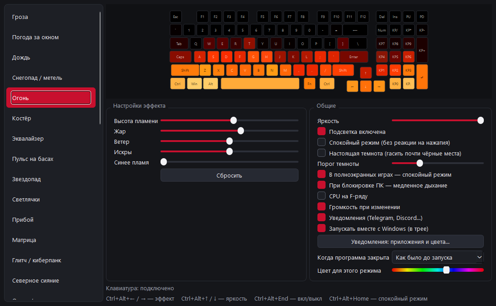

# ARDOR RGB

**Живая подсветка для клавиатур ARDOR GAMING Guardian и AULA F75.** Гроза с молниями, которые бьют в нажатую клавишу; настоящая погода за окном; огонь, разгорающийся от печати; эквалайзер под любую музыку в системе; волна по клавиатуре, когда пишут в Telegram или Discord; индикаторы загрузки CPU и громкости прямо на клавишах.

[English version](README.en.md) · [Все эффекты](docs/EFFECTS.md) · [Архитектура](docs/ARCHITECTURE.md) · [USB-протокол](docs/PROTOCOL.md) ([AULA F75](docs/PROTOCOL_AULA.md)) · [Изменения](CHANGELOG.md) · [Как помочь](docs/CONTRIBUTING.md)

<!-- TODO: видео живой клавиатуры (снять в темноте: Гроза, Огонь, Эквалайзер) -->
> 🎬 *Здесь будет видео живой клавиатуры.*

| Гроза | Огонь | Дождь |
|---|---|---|
|  |  |  |
| **Эквалайзер** | **Матрица** | **Северное сияние** |
|  |  |  |

<sub>Анимации — превью из самой программы (то же окно предпросмотра, что в приложении), а не съёмка клавиатуры. Нажатия и музыка в них синтетические. **Анимации всех 34 эффектов — в [каталоге эффектов](docs/EFFECTS.md).**</sub>

---

## Зачем

Guardian — хорошая клавиатура с поклавишной RGB-подсветкой, но стандартное приложение даёт ей только набор встроенных режимов прошивки. Чтобы периферия ARDOR GAMING стала по-настоящему геймерской, мы переработали управление подсветкой с нуля.

ARDOR RGB берёт подсветку под полный контроль компьютера: каждый кадр (60 раз в секунду) рассчитывается на ПК и отправляется на клавиатуру. Это значит, что эффект может быть каким угодно — физическая симуляция огня, процедурные облака, реакция на звук, на нажатия, на состояние системы.

## Возможности

- **34 собственных эффекта** (плюс режим «Выключено») — все написаны с нуля и рассчитываются программой кадр за кадром, ни один не взят из прошивки клавиатуры:
  - погода и стихии: Гроза, Погода за окном, Дождь, Снегопад / метель, Огонь, Костёр;
  - под музыку: Эквалайзер, Пульс на басах;
  - атмосфера: Звездопад, Светлячки, Прибой, Матрица, Глитч / киберпанк, Северное сияние, Океан / лава, Лавовая лампа;
  - режимы прошивки, переосмысленные: все режимы из списка Guardian переписаны заново — 60 кадров в секунду, плавное движение, 8 направлений, радуга или свой цвет (Цветная волна, Импульс, Радуга, Водоворот, Радужные круги, Радужный водопад, Из стороны в сторону, Стрела, Мозаика, Геометрия, Статичный цвет);
  - простые: Радужная волна, Плазма, Круги от нажатий, Вспышки при печати, Звёзды, Огонь (простой), Дыхание.
- **Реакция на нажатия.** В Грозе молния бьёт в нажатую клавишу, в Огне и Костре вылетают искры, в Дожде — брызги, в Снегопаде — облачко снега, в Звездопаде метеор прилетает в клавишу, светлячки слетаются к ней.
- **Погода за окном.** Реальная погода в вашем городе ([Open-Meteo](https://open-meteo.com/), без регистрации): дождь, снег, метель, гроза, ясное небо днём и звёзды ночью, облака, туман.
- **Гроза 2.0.** Молнии в такт басу музыки и шторм, который сам циклически нарастает и стихает.
- **Уведомления.** Пишут в Telegram или Discord — по клавиатуре проходит волна цвета приложения; в полноэкранной игре вместо волны мигает только `Esc`. Список приложений и цвета настраиваются.
- **Настоящая темнота.** Светодиоды светятся даже на 1–3 %; галочка гасит полностью всё, что в эффекте задумано чёрным (небо между облаками, ночь), — порог настраивается.
- **Что гореть, когда программа закрыта:** прежний режим, выключено, статичный цвет, дыхание, радужная волна или снимок текущего эффекта, записанный в клавиатуру.
- **Музыка из системы.** Эквалайзер и «Пульс на басах» слушают то, что играет на устройстве вывода по умолчанию (WASAPI loopback): музыку, игру, видео. Микрофон не нужен.
- **Индикаторы поверх любого эффекта:**
  - загрузка CPU на ряду F1–F12 (от зелёного к красному);
  - громкость на цифровом ряду — появляется на 1,5 секунды при изменении, красная при выключенном звуке;
  - уведомления — см. выше.
- **Настройки каждого эффекта** ползунками: скорость, цвет, плотность, ветер и т. д. Изменения видны сразу, всё сохраняется.
- **Живой предпросмотр** клавиатуры в окне.
- **Умные режимы:**
  - в полноэкранной игре автоматически включается «спокойный режим» — эффект продолжает идти, но не реагирует на нажатия (WASD не превращает клавиатуру в стробоскоп);
  - на экране блокировки — медленное «дыхание»;
  - перед сном ПК подсветка гаснет, после пробуждения возвращается.
- **Глобальные горячие клавиши**, работающие в любой программе.
- **Трей и автозапуск** с Windows.
- **Плавные переходы** между эффектами (кроссфейд 0,5 с).
- **Безопасный выход:** при закрытии программы клавиатура возвращается в тот режим подсветки, который был до запуска (или в выбранный вами).
- **Переподключение:** выдернули кабель — программа ждёт и подхватывает клавиатуру снова.

## Совместимость

| Клавиатура | USB VID:PID | Подключение | Статус |
|---|---|---|---|
| ARDOR GAMING Guardian (98%) | `320F:5055` | кабель | ✅ проверено |
| ARDOR GAMING Guardian (98%) | `320F:5088` (донгл) | 2.4 ГГц | 🔬 протокол работает, в программе пока нет |
| AULA F75 (75%) | `258A:010C` | кабель | ✅ проверено ([протокол](docs/PROTOCOL_AULA.md)) |
| AULA F75 (75%) | `3554:FA09` (приёмник) | 2.4 ГГц | ❌ протокол другой, не разобран |
| Другие клавиатуры на контроллере Telink / EVision `320F:5055` | `320F:5055` | кабель | ❓ протокол, скорее всего, тот же, но карта светодиодов будет другой |

- **ОС:** только Windows 10 / 11 (используются WinAPI: глобальные хоткеи, WASAPI, события питания, реестр).
- **Подключение:** программа работает по кабелю. По радио протокол проверен (около 14 полных кадров в секунду против 60 по кабелю, подробности в [протоколе](docs/PROTOCOL.md#беспроводной-режим-24-ггц)), поддержка — в планах.
- **Какая клавиатура:** программа сама находит подключённую. Если подключены обе, выбрать можно в `settings.json` (`"board": "guardian"` или `"aula_f75"`) или переменной окружения `ARDOR_BOARD`. Клавиатура выбирается при запуске; чтобы сменить, перезапустите программу.
- **AULA F75:** 30 кадров в секунду (у Guardian — 60); пока программа работает, в клавиатуре стоит эффект «ВЫКЛ» — только поверх него клавиатура показывает присланные кадры. Режим выхода «Радужная волна (прошивка)» для AULA недоступен.
- **Другая модель?** Если клавиатура определяется, но клавиши горят «не те» — карту светодиодов можно снять утилитой `tools/probe.py`, см. [CONTRIBUTING](docs/CONTRIBUTING.md).

## Установка

**Проще всего:** скачайте `ARDOR-RGB.exe` со страницы [Releases](https://github.com/StormMagic1337/ardor-rgb/releases/latest) и запустите — Python не нужен. Один exe для обеих клавиатур. Windows может предупредить, что программа неизвестна (у неё нет цифровой подписи): «Подробнее» → «Выполнить в любом случае».

**Из исходников:** нужен **Python 3.10+** (проверено на 3.12) и **git**.

```powershell
git clone https://github.com/StormMagic1337/ardor-rgb.git
cd ardor-rgb
py -3.12 -m venv .venv
.venv\Scripts\activate
pip install -r requirements.txt
```

> ⚠️ Пакет для USB называется **`hidapi`** (импортируется как `hid`). На PyPI есть другой, несовместимый пакет `hid` — его ставить не нужно.

Собрать exe самому: `pip install pyinstaller`, затем `tools\build_exe.bat` → `dist\ARDOR-RGB.exe`.

## Запуск

> **Перед запуском закройте фирменное приложение (Guardian или программу AULA — OemDrv.exe, в том числе в трее).** Оба работают с одним и тем же интерфейсом клавиатуры и будут перебивать друг друга.

```powershell
pythonw app.py           # окно
pythonw app.py --tray    # сразу в трей (так стартует автозапуск)
```

Программа запускается в одном экземпляре: повторный запуск просто откроет уже работающее окно. Закрытие окна (крестик) сворачивает программу в трей; полностью выйти — через меню трея → «Выход».

### Окно



- **Слева** — список эффектов.
- **Сверху** — живой предпросмотр того, что сейчас на клавиатуре.
- **«Настройки эффекта»** — ползунки и переключатели текущего эффекта, кнопка «Сбросить» возвращает значения по умолчанию.
- **«Общие»:**
  - яркость (программная, 0–100 %);
  - подсветка вкл / выкл;
  - спокойный режим (без реакции на нажатия);
  - спокойный режим в полноэкранных играх;
  - «дыхание» при блокировке ПК;
  - «Настоящая темнота» и порог темноты;
  - индикаторы CPU, громкости и уведомлений;
  - «Уведомления: приложения и цвета…» — список приложений, шаблон их системного имени, цвет и кнопка «Проверить»;
  - запуск вместе с Windows (в трее);
  - «Когда программа закрыта» — что оставить на клавиатуре после выхода, и цвет для этого режима.
- **Строка состояния** — подключена ли клавиатура, какой авто-режим действует и сводка погоды, если выбран эффект «Погода за окном».

### Горячие клавиши

Работают глобально, в любой программе.

| Сочетание | Действие |
|---|---|
| `Ctrl+Alt+→` / `Ctrl+Alt+←` | следующий / предыдущий эффект |
| `Ctrl+Alt+↑` / `Ctrl+Alt+↓` | яркость +10 % / −10 % |
| `Ctrl+Alt+End` | подсветка вкл / выкл |
| `Ctrl+Alt+Home` | спокойный режим вкл / выкл |

Если какое-то сочетание уже занято другой программой, ARDOR RGB покажет уведомление в трее, остальные будут работать.

### Консольный режим

Для отладки эффектов без GUI:

```powershell
python run.py --list                      # эффекты и их параметры
python run.py storm                       # запустить эффект
python run.py storm frequency=2 rain=0    # с параметрами
python run.py fire --calm                 # без реакции на нажатия
python run.py fire --cpu --volume         # с индикаторами CPU и громкости
```

`Ctrl+C` останавливает и возвращает клавиатуре её собственный режим подсветки.

## Эффекты

| Группа | Эффекты | Реакция на нажатия |
|---|---|---|
| **Погода и стихии** | Гроза, Погода за окном, Дождь, Снегопад / метель, Огонь, Костёр | молния в клавишу, брызги, снег, искры |
| **Под музыку** | Эквалайзер, Пульс на басах | — |
| **Атмосфера** | Звездопад, Светлячки, Прибой, Матрица, Глитч / киберпанк, Северное сияние, Океан / лава, Лавовая лампа | метеор, светлячки, всплеск, поток, сбой ряда, капля |
| **Режимы прошивки, переосмысленные** | Цветная волна, Импульс, Радуга, Водоворот, Радужные круги, Радужный водопад, Из стороны в сторону, Стрела, Мозаика, Геометрия, Статичный цвет | стрелы, смена цвета |
| **Простые** | Радужная волна, Плазма, Круги от нажатий, Вспышки при печати, Звёзды, Огонь (простой), Дыхание, Выключено | круги, вспышки |

Анимация каждого эффекта, все его параметры и как написать свой: [docs/EFFECTS.md](docs/EFFECTS.md).

## Как это работает (коротко)

1. При старте программа читает текущий режим подсветки клавиатуры, запоминает его и переключает клавиатуру в **потоковый режим** — в нём клавиатура просто показывает те цвета, которые ей присылают.
2. Движок 60 раз в секунду рассчитывает кадр активного эффекта (NumPy, один массив на все клавиши), накладывает индикаторы и яркость и отправляет кадр по USB (Guardian — 7 HID-пакетов по 64 байта; AULA F75 — 30 раз в секунду, один Feature-отчёт на 520 байт).
3. При выходе в клавиатуру записывается сохранённый режим — она снова светится так, как была настроена в Guardian (или выбранный вами режим «когда программа закрыта»).

Ничего не прошивается: программа меняет только настройку режима подсветки (то же самое, что делает Guardian при выборе режима) и шлёт кадры в оперативную память клавиатуры. В постоянную память цвета пишутся только в одном случае — если выбран режим выхода «Снимок эффекта», один раз при закрытии.

Подробно: [архитектура](docs/ARCHITECTURE.md) и [USB-протокол](docs/PROTOCOL.md).

## Где хранятся данные

| Файл | Что внутри |
|---|---|
| `%APPDATA%\ardor-rgb\settings.json` | выбранный эффект, яркость, параметры эффектов, переключатели |
| `%APPDATA%\ardor-rgb\hw_config.bin` | копия «родного» режима подсветки клавиатуры (34 байта) — чтобы вернуть его, даже если программа была завершена аварийно |
| `%APPDATA%\ardor-rgb\exit_config.bin` | режим, в котором программа оставила клавиатуру при выходе (если выбран не «как было») — чтобы не принять его за «родной» |
| `%APPDATA%\ardor-rgb\aula_hw_config.bin`, `aula_exit_config.bin` | то же для AULA F75 (128 байт) |
| `HKCU\Software\Microsoft\Windows\CurrentVersion\Run` → `ArdorRGB` | только если включён автозапуск |

Приватность:
- **Нажатия** опрашиваются лишь для анимации текущего кадра — они нигде не сохраняются и никуда не отправляются.
- **Сеть** используется только эффектом «Погода за окном»: название города и его координаты уходят в [Open-Meteo](https://open-meteo.com/) раз в 10 минут, пока эффект включён. Больше сетевых запросов программа не делает.
- **Уведомления** определяются по базе уведомлений Windows, открытой только на чтение. Из записи берётся лишь системное имя приложения; текст сообщений не читается.

## Отказ от ответственности

- **Это неофициальный проект.** Он не связан с ARDOR GAMING, DNS или производителем контроллера и не одобрен ими. ARDOR GAMING, Guardian и другие названия — товарные знаки их владельцев и упоминаются только для указания совместимости.
- **Протокол восстановлен** анализом USB-обмена между клавиатурой и фирменным приложением с целью совместимости. Прошивка клавиатуры не изменяется и не читается.
- **Что именно пишется в клавиатуру:** настройка режима подсветки (команда `0x06`, ровно то, что делает Guardian при переключении режима) и кадры цветов в оперативную память (команда `0x12`, теряются при отключении). Если выбран режим выхода «Снимок эффекта», при закрытии один раз пишутся поклавишные цвета (команда `0x0B`, как при сохранении «Пользовательского» режима в Guardian). При выходе исходный режим восстанавливается, если не выбран другой.
- **AULA F75:** пишется конфигурация подсветки (команда `0x04`, как при выборе эффекта в программе AULA) и кадры в оперативную память (команда `0x08`, как в её режиме «Музыка»). При выходе в «Статичный цвет» / «Дыхание» — таблица цветов эффектов (`0x0A`), в «Снимок эффекта» — поклавишные цвета (`0x06`). Подробно — [протокол AULA](docs/PROTOCOL_AULA.md).
- **Не запускайте одновременно с Guardian** — приложения будут перебивать друг друга.
- Программа распространяется «как есть», без каких-либо гарантий (см. [LICENSE](LICENSE)). Вы используете её на свой страх и риск.

## Планы

- [x] **Готовый `.exe`** в [Releases](https://github.com/StormMagic1337/ardor-rgb/releases/latest) — запуск без установки Python.
- [ ] Видео работы на живой клавиатуре.
- [ ] Работа по радио (2.4 ГГц): отправка только изменившихся частей кадра, индикатор заряда батареи.
- [ ] Настройки самой клавиатуры в окне: блокировка Win, WASD ↔ стрелки, anti-ghosting, частота опроса, автоповтор (команды снимаются утилитой `tools/sniff_steps.py`).
- [ ] Поддержка других моделей на `320F:5055` (нужны владельцы — см. [CONTRIBUTING](docs/CONTRIBUTING.md)).

## Структура проекта

```
app.py                 окно, трей, горячие клавиши, системные события
run.py                 консольный запуск эффектов
ardor/
  device.py            выбранная клавиатура (фасад над devices/)
  devices/             клавиатуры: протокол, раскладка, режимы выхода
    guardian.py        ARDOR GAMING Guardian
    aula_f75.py        AULA F75
  engine.py            цикл рендера: эффект → индикаторы → яркость → USB
  layout.py            карта светодиодов и координаты клавиш выбранной клавиатуры
  effects/             эффекты (по файлу на семейство)
  overlays.py          индикаторы CPU, громкости и уведомлений
  audio.py             захват и анализ системного звука
  weather.py           текущая погода (Open-Meteo)
  notifications.py     наблюдение за уведомлениями Windows
  winsys.py            WinAPI: хоткеи, блокировка, полноэкранные приложения, автозапуск
  settings.py          сохранение настроек
tools/
  probe.py             снятие карты светодиодов
  legacy_ardor.py      первая версия одним файлом — минимальный пример протокола
  sniff_steps.py       пошаговый перехват USB-обмена Guardian (Frida, нужен админ)
  aula_hidlog/         подменная hid.dll для записи обмена программы AULA (C, MSVC)
  aula_analyze_log.py  разбор её лога по шагам
  build_exe.bat        сборка dist\ARDOR-RGB.exe (PyInstaller), один exe для обеих клавиатур
  render_previews.py   рендер GIF / WebP и скриншота для документации
  gen_effects_doc.py   генерация каталога эффектов из кода
docs/                  подробная документация, docs/media/effects — анимации всех эффектов
```

## Лицензия

[MIT](LICENSE) © 2026 StormMagic1337
