# Эффекты

[English version](EFFECTS.en.md) · [← README](../README.md) · [Архитектура](ARCHITECTURE.md)

Все эффекты лежат в [`ardor/effects/`](../ardor/effects/) — **все они собственные**: каждый кадр считает программа, ни один эффект не берётся из прошивки клавиатуры. Порядок разделов ниже = порядок в окне и при переключении `Ctrl+Alt+←/→` (эффект «Выключено» хоткеями пропускается).

Колонка с кодом — идентификатор для `run.py` и `settings.json`. Тип «цвет» — оттенок по кругу HSV (0 = красный, 0,33 = зелёный, 0,66 = синий, 1 = снова красный); в окне для него показывается ползунок с радугой.

**Реакция на нажатия** во всех эффектах отключается в спокойном режиме. Превью — анимации из самой программы (тот же виджет, что в окне), нажатия и музыка в них синтетические. Каталог ниже генерируется скриптом [`tools/gen_effects_doc.py`](../tools/gen_effects_doc.py) — таблицы параметров берутся прямо из кода.

<!-- effects:start -->

## Погода и стихии

### Гроза — `storm`

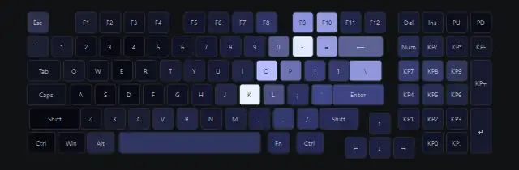

Тёмные облака из фрактального шума плывут по ветру. В них вспыхивают зарницы и бьют ветвистые молнии: ломаный путь сверху вниз с боковыми ветвями, 1–3 импульса с послесвечением. Поверх идёт дождь. Молнии можно привязать к басу музыки, а шторм — заставить циклически нарастать и стихать.

**Нажатие:** молния бьёт точно в нажатую клавишу.

| Параметр | Название в окне | Тип | Диапазон | По умолчанию |
|---|---|---|---|---|
| `frequency` | Частота молний | число | 0 … 3 | 1 |
| `wind` | Ветер | число | 0 … 3 | 1 |
| `clouds` | Яркость облаков | число | 0 … 2 | 1 |
| `rain` | Дождь | число | 0 … 1 | 0,3 |
| `music` | Молнии в такт музыке (бас) | вкл/выкл | 0 / 1 | 0 |
| `cycles` | Шторм нарастает и стихает | вкл/выкл | 0 / 1 | 0 |
| `cycle_min` | Длина цикла, мин | число | 1 … 10 | 4 |

### Погода за окном — `weather`

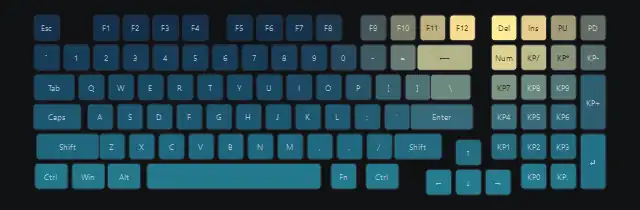

Показывает реальную погоду в выбранном городе (данные [Open-Meteo](https://open-meteo.com/), без ключей, обновление раз в 10 минут): дождь, снег или метель, грозу, ясное небо (днём тёплое с солнцем, ночью звёзды и метеоры), облачность, туман. Сила дождя и снега берётся из количества осадков, ветер — с улицы. Смена погоды перетекает плавно за 3 с, сводка видна в строке состояния. «Показать» позволяет вручную выбрать любую погоду (превью снято с «Ясно»).

**Нажатие:** в дождь, снег и грозу — как в этих эффектах; при ясном небе, облаках и тумане реакции нет.

| Параметр | Название в окне | Тип | Диапазон | По умолчанию |
|---|---|---|---|---|
| `city` | Город | текст | — | Новосибирск |
| `force` | Показать | выбор | Авто (как на улице) / Ясно / Переменная облачность / Пасмурно / Туман / Дождь / Снег / Гроза | Авто (как на улице) |
| `night` | Ночь (если показ не авто) | вкл/выкл | 0 / 1 | 0 |

### Дождь — `rain`

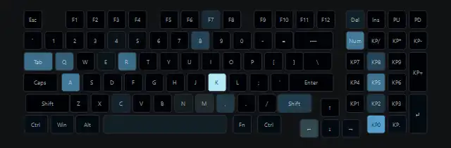

Капли со шлейфами разной скорости, снос ветром, брызги от удара о нижний ряд, мерцающие «лужи».

**Нажатие:** брызги от нажатой клавиши.

| Параметр | Название в окне | Тип | Диапазон | По умолчанию |
|---|---|---|---|---|
| `density` | Сила дождя | число | 0,1 … 3 | 1 |
| `speed` | Скорость капель | число | 0,3 … 2,5 | 1 |
| `wind` | Ветер | число | -2 … 2 | 0,3 |
| `hue` | Цвет | цвет | 0 … 1 | 0,56 |
| `splash` | Брызги | вкл/выкл | 0 / 1 | 1 |

### Снегопад / метель — `snow`

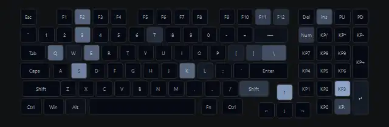

Снежинки разной скорости покачиваются и сносятся ветром, иногда налетают порывы метели — снег густеет и летит почти горизонтально. Упавший снег копится сугробами на нижних рядах и медленно тает.

**Нажатие:** из клавиши вылетает облачко снега.

| Параметр | Название в окне | Тип | Диапазон | По умолчанию |
|---|---|---|---|---|
| `density` | Снегопад | число | 0,1 … 3 | 1 |
| `wind` | Ветер | число | -2 … 2 | 0,4 |
| `blizzard` | Порывы метели | число | 0 … 1 | 0,3 |
| `drifts` | Сугробы внизу | вкл/выкл | 0 / 1 | 1 |

### Огонь — `fire`

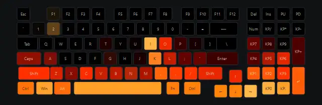

Алгоритм «Doom fire» на сетке 30 × 80: жар поднимается со случайным сносом и остывает, получаются отдельные языки. Палитра «чёрный → красный → оранжевый → жёлтый → белый», искры, угли внизу. Симуляция идёт 45 шагов в секунду и не зависит от FPS.

**Нажатие:** вспышка жара и 6 искр из клавиши.

| Параметр | Название в окне | Тип | Диапазон | По умолчанию |
|---|---|---|---|---|
| `height` | Высота пламени | число | 0,3 … 2 | 1,2 |
| `intensity` | Жар | число | 0,3 … 1,5 | 1 |
| `wind` | Ветер | число | -1,5 … 1,5 | 0 |
| `sparks` | Искры | число | 0 … 2 | 1 |
| `cool` | Синее пламя | число | 0 … 1 | 0 |

### Костёр — `campfire`

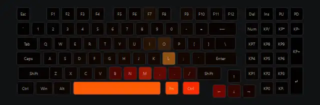

Небольшое пламя по центру нижних рядов, тёплый мерцающий отсвет на соседних клавишах и редкие искры вверх. Уютнее, чем «Огонь».

**Нажатие:** костёр разгорается сильнее.

| Параметр | Название в окне | Тип | Диапазон | По умолчанию |
|---|---|---|---|---|
| `size` | Размер костра | число | 0,3 … 1,5 | 0,8 |
| `glow` | Отсвет вокруг | число | 0 … 1 | 0,5 |
| `sparks` | Искры | число | 0 … 2 | 1 |

## Под музыку

### Эквалайзер — `music_eq`

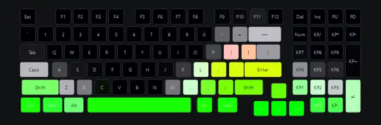

19 полос спектра системного звука, по одной на столбец клавиатуры (басы слева). Верхняя клавиша загорается плавно, белые пики падают медленнее столбиков. Работает с любым звуком из колонок или наушников.

| Параметр | Название в окне | Тип | Диапазон | По умолчанию |
|---|---|---|---|---|
| `sensitivity` | Чувствительность | число | 0,3 … 3 | 1 |
| `style` | Цвет: 0 зелёный→красный, 1 радуга | вкл/выкл | 0 / 1 | 0 |
| `hue` | Сдвиг цвета | цвет | 0 … 1 | 0 |
| `caps` | Падающие пики | вкл/выкл | 0 / 1 | 1 |

### Пульс на басах — `music_pulse`

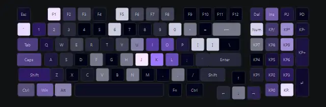

Клавиатура дышит басом из центра; на каждый удар баса расходится кольцо и сдвигается цвет. Высокие частоты рассыпают белые искры.

| Параметр | Название в окне | Тип | Диапазон | По умолчанию |
|---|---|---|---|---|
| `sensitivity` | Чувствительность | число | 0,3 … 3 | 1 |
| `hue_step` | Смена цвета на долю | число | 0 … 0,5 | 0,13 |
| `sparkle` | Искры от высоких | число | 0 … 2 | 1 |

## Атмосфера

### Звездопад — `meteors`

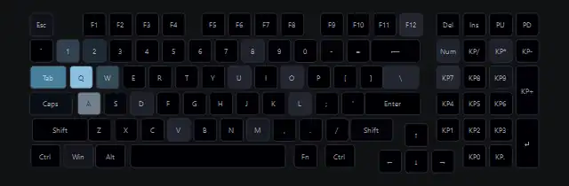

Ночное небо с мерцающими звёздами; время от времени по диагонали пролетает метеор с ярким ядром и длинным хвостом.

**Нажатие:** метеор прилетает в нажатую клавишу и вспыхивает.

| Параметр | Название в окне | Тип | Диапазон | По умолчанию |
|---|---|---|---|---|
| `frequency` | Частота метеоров | число | 0,1 … 3 | 1 |
| `stars` | Звёзды | число | 0 … 1 | 0,6 |
| `hue` | Цвет хвоста | цвет | 0 … 1 | 0,55 |

### Светлячки — `fireflies`

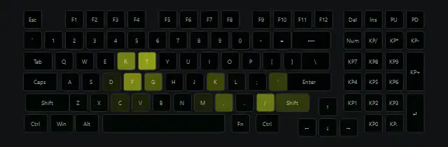

Тёплые точки медленно летают в темноте и мерцают каждая в своём ритме.

**Нажатие:** светлячки слетаются к нажатой клавише.

| Параметр | Название в окне | Тип | Диапазон | По умолчанию |
|---|---|---|---|---|
| `count` | Количество | целое | 3 … 25 | 12 |
| `hue` | Цвет | цвет | 0 … 1 | 0,18 |
| `speed` | Скорость | число | 0,2 … 3 | 1 |

### Прибой — `surf`

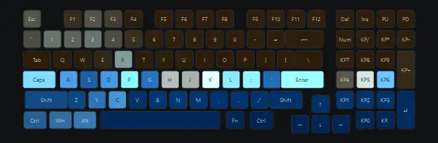

Волны накатывают снизу на «песок»: вода с пенной кромкой поднимается и отступает, оставляя мокрый песок.

**Нажатие:** по воде расходится всплеск.

| Параметр | Название в окне | Тип | Диапазон | По умолчанию |
|---|---|---|---|---|
| `speed` | Скорость волн | число | 0,3 … 2,5 | 1 |
| `height` | Высота волн | число | 0,3 … 1,5 | 1 |

### Матрица — `matrix`

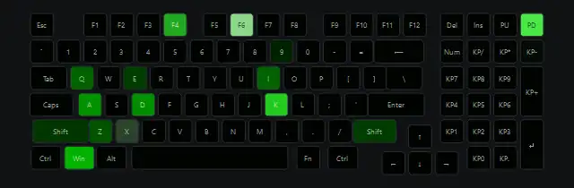

Потоки падают по столбцам с яркой головой и затухающим мерцающим хвостом.

**Нажатие:** новый поток стартует с нажатой клавиши.

| Параметр | Название в окне | Тип | Диапазон | По умолчанию |
|---|---|---|---|---|
| `density` | Плотность | число | 0,2 … 3 | 1 |
| `speed` | Скорость | число | 0,3 … 3 | 1 |
| `hue` | Цвет | цвет | 0 … 1 | 0,33 |

### Глитч / киберпанк — `glitch`

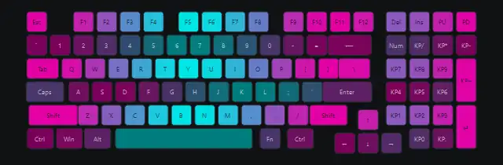

Две неоновые краски переливаются со сканирующими полосами, поверх — сбои: сдвиг ряда, блок случайных цветов, перестановка каналов, короткое выключение.

**Нажатие:** сбой ряда нажатой клавиши.

| Параметр | Название в окне | Тип | Диапазон | По умолчанию |
|---|---|---|---|---|
| `chaos` | Частота сбоев | число | 0 … 3 | 1 |
| `hue1` | Неон 1 | цвет | 0 … 1 | 0,88 |
| `hue2` | Неон 2 | цвет | 0 … 1 | 0,5 |

### Северное сияние — `aurora`

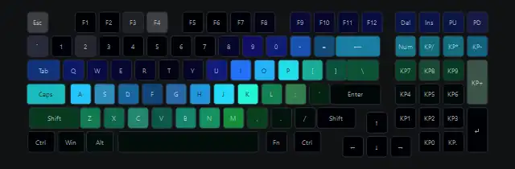

Волнистая занавесь с вертикальными лучами медленно колышется; низ одного цвета, верх другого, вокруг редкие звёзды.

**Нажатие:** сияние вспыхивает над клавишей.

| Параметр | Название в окне | Тип | Диапазон | По умолчанию |
|---|---|---|---|---|
| `speed` | Скорость | число | 0,2 … 3 | 1 |
| `hue1` | Цвет низа | цвет | 0 … 1 | 0,38 |
| `hue2` | Цвет верха | цвет | 0 … 1 | 0,8 |
| `stars` | Звёзды | вкл/выкл | 0 / 1 | 1 |

### Океан / лава — `liquid`

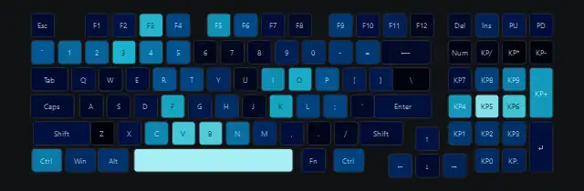

Медленно текущая жидкость (шум с domain warping) в палитре океана или лавы.

**Нажатие:** по поверхности расходится круг.

| Параметр | Название в окне | Тип | Диапазон | По умолчанию |
|---|---|---|---|---|
| `lava` | 0 океан, 1 лава | вкл/выкл | 0 / 1 | 0 |
| `speed` | Скорость | число | 0,2 … 3 | 1 |
| `scale` | Масштаб волн | число | 0,5 … 2 | 1 |

### Лавовая лампа — `lavalamp`

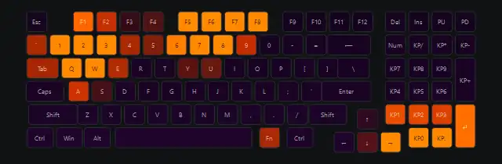

Капли метабол медленно поднимаются и опускаются, растягиваются и сливаются, как в настоящей лампе.

**Нажатие:** со дна всплывает новая капля.

| Параметр | Название в окне | Тип | Диапазон | По умолчанию |
|---|---|---|---|---|
| `speed` | Скорость | число | 0,2 … 3 | 1 |
| `blobs` | Капли | целое | 3 … 10 | 6 |
| `hue_blob` | Цвет капель | цвет | 0 … 1 | 0,04 |
| `hue_liquid` | Цвет жидкости | цвет | 0 … 1 | 0,78 |

## Режимы прошивки, переосмысленные

Каждый режим из списка Guardian переписан как наш эффект: 60 кадров в секунду, плавное движение и настройки, которых у прошивки нет (8 направлений, радуга или один цвет, ширина). Прошивка в этих эффектах не участвует.

### Цветная волна — `fw_wave`

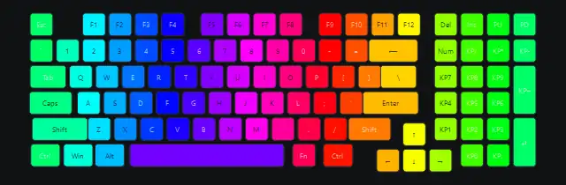

Цветная волна в любом из 8 направлений, включая «от центра» и вращение. Прошивка: «Пульсация», «Волна».

| Параметр | Название в окне | Тип | Диапазон | По умолчанию |
|---|---|---|---|---|
| `speed` | Скорость | число | 0 … 3 | 1 |
| `rainbow` | Радуга | вкл/выкл | 0 / 1 | 1 |
| `hue` | Цвет (если не радуга) | цвет | 0 … 1 | 0 |
| `direction` | Направление | выбор | Слева направо / Справа налево / Сверху вниз / Снизу вверх / От центра / К центру / По часовой / Против часовой | Слева направо |
| `width` | Ширина | число | 0,2 … 3 | 1 |

### Импульс (облака цвета) — `fw_clouds`

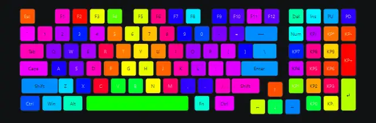

Мягкие цветные пятна плывут по клавиатуре. Прошивка: «Импульс».

| Параметр | Название в окне | Тип | Диапазон | По умолчанию |
|---|---|---|---|---|
| `speed` | Скорость | число | 0 … 3 | 1 |
| `scale` | Размер пятен | число | 0,3 … 3 | 1 |

### Радуга (вся клавиатура) — `fw_spectrum`

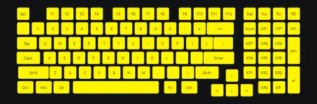

Вся клавиатура одним цветом плавно проходит радугу. Прошивка: «Радуга».

| Параметр | Название в окне | Тип | Диапазон | По умолчанию |
|---|---|---|---|---|
| `speed` | Скорость | число | 0 … 3 | 1 |

### Водоворот — `fw_vortex`

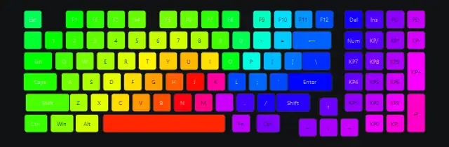

Радужная спираль вращается вокруг центра. Прошивка: «Водопад».

| Параметр | Название в окне | Тип | Диапазон | По умолчанию |
|---|---|---|---|---|
| `speed` | Скорость | число | 0 … 3 | 1 |
| `twist` | Закрутка | число | 0 … 2 | 0,6 |
| `clockwise` | По часовой | вкл/выкл | 0 / 1 | 1 |

### Радужные круги — `fw_rings`

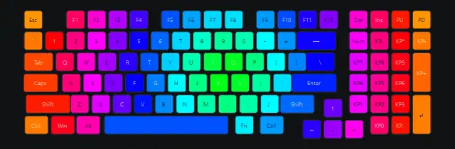

Радужные кольца расходятся от центра или сходятся к нему. Прошивка: «Радужные переливы».

| Параметр | Название в окне | Тип | Диапазон | По умолчанию |
|---|---|---|---|---|
| `speed` | Скорость | число | 0 … 3 | 1 |
| `width` | Ширина | число | 0,2 … 3 | 1 |
| `inward` | К центру | вкл/выкл | 0 / 1 | 0 |

### Радужный водопад — `fw_rainfall`

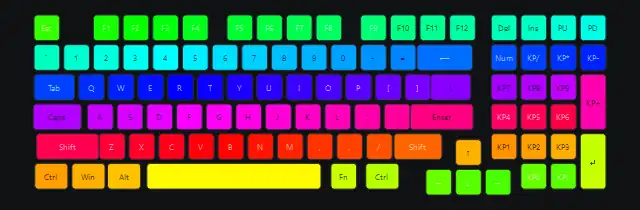

Радуга стекает сверху вниз или поднимается. Прошивка: «Радужный водопад».

| Параметр | Название в окне | Тип | Диапазон | По умолчанию |
|---|---|---|---|---|
| `speed` | Скорость | число | 0 … 3 | 1 |
| `width` | Ширина | число | 0,2 … 3 | 1 |
| `up` | Снизу вверх | вкл/выкл | 0 / 1 | 0 |

### Из стороны в сторону — `fw_scanner`

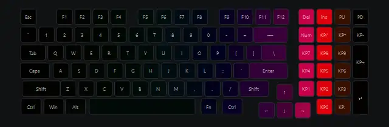

Луч ходит из стороны в сторону с плавным разворотом и шлейфом, можно вертикально. Прошивка: «Из стороны в сторону».

| Параметр | Название в окне | Тип | Диапазон | По умолчанию |
|---|---|---|---|---|
| `speed` | Скорость | число | 0 … 3 | 1 |
| `rainbow` | Радуга | вкл/выкл | 0 / 1 | 1 |
| `hue` | Цвет (если не радуга) | цвет | 0 … 1 | 0 |
| `width` | Ширина луча | число | 0,5 … 5 | 2 |
| `trail` | Шлейф | число | 0 … 1 | 0,6 |
| `vertical` | Вертикально | вкл/выкл | 0 / 1 | 0 |

### Стрела — `fw_arrow`

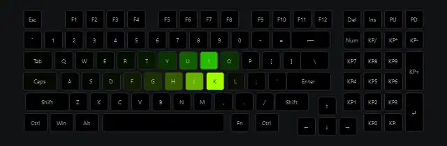

От нажатой клавиши по её ряду разлетаются стрелы с хвостами; в спокойном режиме — сами. Прошивка: «Стрела».

**Нажатие:** стрелы от клавиши влево и вправо.

| Параметр | Название в окне | Тип | Диапазон | По умолчанию |
|---|---|---|---|---|
| `speed` | Скорость | число | 0 … 3 | 1 |
| `rainbow` | Радуга | вкл/выкл | 0 / 1 | 1 |
| `hue` | Цвет (если не радуга) | цвет | 0 … 1 | 0 |
| `length` | Длина хвоста | число | 0,5 … 4 | 1,5 |

### Разноцветная мозаика — `fw_mosaic`

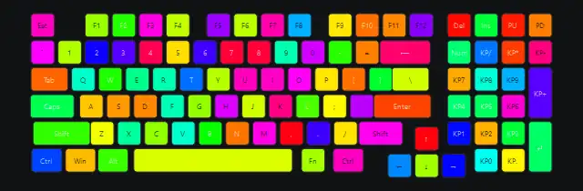

Клавиши плавно перетекают в новые случайные цвета. Прошивка: «Разноцветная мозаика».

**Нажатие:** клавиша меняет цвет.

| Параметр | Название в окне | Тип | Диапазон | По умолчанию |
|---|---|---|---|---|
| `speed` | Скорость | число | 0,1 … 3 | 1 |
| `saturation` | Насыщенность | число | 0 … 1 | 1 |

### Геометрия — `fw_geometry`

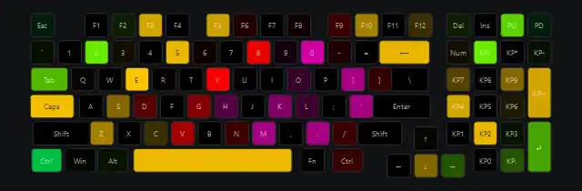

Квадраты, ромбы или круги расходятся от центра. Прошивка: «Геометрический рисунок».

| Параметр | Название в окне | Тип | Диапазон | По умолчанию |
|---|---|---|---|---|
| `speed` | Скорость | число | 0 … 3 | 1 |
| `rainbow` | Радуга | вкл/выкл | 0 / 1 | 1 |
| `hue` | Цвет (если не радуга) | цвет | 0 … 1 | 0 |
| `shape` | Фигура | выбор | Квадраты / Ромбы / Круги | Ромбы |
| `gap` | Шаг | число | 1 … 6 | 3 |

### Статичный цвет — `fw_static`

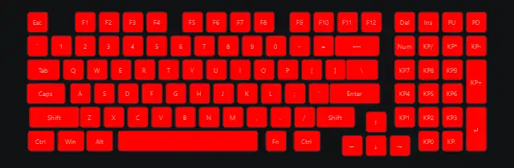

Один цвет с насыщенностью и яркостью или приглушённая радуга по клавишам. Прошивка: «Статичный», «Приглушённая разноцветная», «Приглушённая белая».

| Параметр | Название в окне | Тип | Диапазон | По умолчанию |
|---|---|---|---|---|
| `hue` | Цвет | цвет | 0 … 1 | 0 |
| `saturation` | Насыщенность | число | 0 … 1 | 1 |
| `level` | Яркость | число | 0,05 … 1 | 1 |
| `rainbow` | Радуга по клавишам (приглушённая разноцветная) | вкл/выкл | 0 / 1 | 0 |

## Простые

Тоже собственные эффекты программы, просто устроены проще. Первые шесть перенесены из первой версии ([`tools/legacy_ardor.py`](../tools/legacy_ardor.py)).

### Радужная волна — `wave`

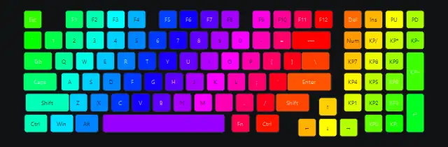

Радуга бежит по диагонали.

| Параметр | Название в окне | Тип | Диапазон | По умолчанию |
|---|---|---|---|---|
| `speed` | Скорость | число | 0 … 3 | 1 |
| `width` | Ширина радуги | число | 0,3 … 3 | 1 |

### Плазма — `plasma`

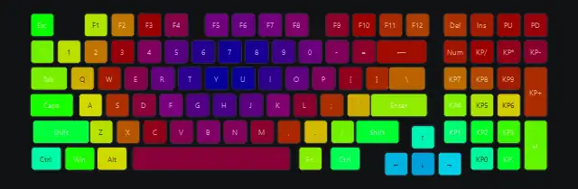

Сумма синусоид — переливающиеся цвета.

| Параметр | Название в окне | Тип | Диапазон | По умолчанию |
|---|---|---|---|---|
| `speed` | Скорость | число | 0 … 3 | 1 |

### Круги от нажатий — `ripple`

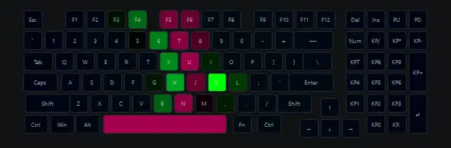

Цветные кольца от клавиш; в спокойном режиме появляются сами.

**Нажатие:** кольцо от клавиши.

| Параметр | Название в окне | Тип | Диапазон | По умолчанию |
|---|---|---|---|---|
| `speed` | Скорость кругов | число | 0,3 … 3 | 1 |
| `bg` | Фон | число | 0 … 1 | 0,3 |

### Вспышки при печати — `typing`

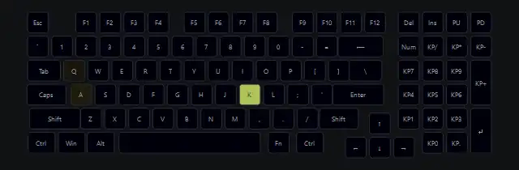

Нажатая клавиша вспыхивает и гаснет.

**Нажатие:** вспышка клавиши.

| Параметр | Название в окне | Тип | Диапазон | По умолчанию |
|---|---|---|---|---|
| `fade` | Затухание | число | 0,3 … 3 | 1 |
| `hue` | Цвет | цвет | 0 … 1 | 0 |
| `rainbow` | Радужный | вкл/выкл | 0 / 1 | 1 |

### Звёзды — `stars`

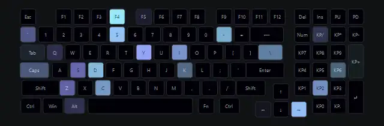

Клавиши плавно загораются и гаснут в случайном порядке.

| Параметр | Название в окне | Тип | Диапазон | По умолчанию |
|---|---|---|---|---|
| `density` | Плотность | число | 0,1 … 3 | 1 |
| `hue` | Оттенок | цвет | 0 … 1 | 0,6 |

### Огонь (простой) — `fire_classic`

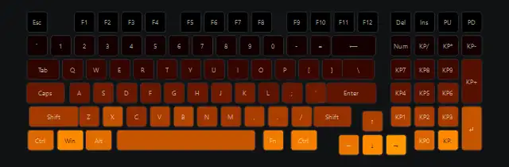

Нижние ряды «горят» случайной яркостью.

| Параметр | Название в окне | Тип | Диапазон | По умолчанию |
|---|---|---|---|---|
| `height` | Высота | число | 0,3 … 2 | 1 |

### Дыхание — `breathe`

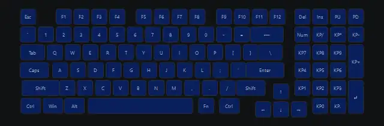

Один цвет плавно разгорается и гаснет, можно менять цвет на каждом вдохе. Включается и на экране блокировки.

| Параметр | Название в окне | Тип | Диапазон | По умолчанию |
|---|---|---|---|---|
| `hue` | Цвет | цвет | 0 … 1 | 0,62 |
| `period` | Период, с | число | 2 … 12 | 6 |
| `rainbow` | Новый цвет на каждом вдохе | вкл/выкл | 0 / 1 | 0 |

### Выключено — `off`

Всё чёрное; индикаторы и уведомления при этом работают.

<!-- effects:end -->

---

## Как написать свой эффект

### 1. API

```python
class Effect:
    name = ""        # идентификатор: run.py, settings.json
    title = ""       # название в окне
    params = []      # список Param — из него окно само строит ползунки

    def reset(self): ...                               # создать состояние (вызывается из __init__)
    def render(self, t, dt, presses, calm): ...        # вернуть кадр
```

`render` вызывается 60 раз в секунду и получает:

| Аргумент | Что это |
|---|---|
| `t` | секунды с запуска движка |
| `dt` | длительность прошлого кадра, ≤ 0,1 с |
| `presses` | список индексов клавиш, нажатых с прошлого кадра (пустой в спокойном режиме) |
| `calm` | `True` в спокойном режиме |

и возвращает массив **`(N, 3)`** с цветами RGB в диапазоне **0…1**, по строке на клавишу.

Доступно из `ardor/effects/base.py`:

| Имя | Что это |
|---|---|
| `X`, `Y` | массивы координат клавиш в единицах клавиш: `x` 0…18,4 слева направо, `y` 0…5,2 сверху вниз |
| `N` | число клавиш (97) |
| `hsv(h, s, v)` | векторный перевод HSV → RGB, аргументы транслируются (broadcast) до `(N,)` |
| `rgb("ff8800")` | цвет из hex |
| `Noise(rng)` | сглаженный 2D-шум: `noise(x, y)` и фрактальный `noise.fbm(x, y, octaves)` |
| `self.p` | словарь текущих значений параметров |
| `self.rng` | генератор случайных чисел NumPy |

Для эффектов на сетке (как «Огонь») есть `layout.sample(grid)` — билинейная выборка сетки в координатах клавиш. Номер клавиши по имени — `layout.slot_of("Space")`.

`Param(name, title, lo, hi, default, kind, options)`, где `kind`:
- `"float"` — ползунок (200 шагов);
- `"int"` — ползунок с целыми шагами;
- `"hue"` — ползунок с радугой;
- `"bool"` — галочка (значение 0 или 1);
- `"choice"` — выпадающий список, подписи в `options`, значение — номер пункта;
- `"text"` — поле ввода, значение — строка (например, город в «Погоде»).

Числовые значения приходят числом (`float`), даже для `bool` и `choice`.

Необязательный метод `info(self) -> str | None` — строка для строки состояния окна (так «Погода» показывает сводку).

### 2. Пример: «Комета»

Создайте `ardor/effects/comet.py`:

```python
"""Comet: a bright dot flies along a row; a key press launches a comet from that key."""
import numpy as np
from .base import Effect, Param, hsv, X, Y, N


class Comet(Effect):
    name, title = "comet", "Комета"
    params = [
        Param("speed", "Скорость", 2.0, 20.0, 8.0),
        Param("tail", "Длина хвоста", 0.5, 6.0, 2.0),
        Param("hue", "Цвет", 0.0, 1.0, 0.08, "hue"),
    ]

    def reset(self):
        self.comets = []                                   # (x старта, ряд, время старта)

    def render(self, t, dt, presses, calm):
        p = self.p
        for k in presses:                                  # нажатие запускает комету от клавиши
            self.comets.append((X[k], Y[k], t))
        if not self.comets:                                # без нажатий — по случайному ряду
            self.comets.append((-1.0, float(self.rng.integers(0, 6)), t))
        v = np.zeros(N)
        alive = []
        for x0, row, t0 in self.comets:
            head = x0 + (t - t0) * p["speed"]
            if head - p["tail"] > 19:                      # улетела за край
                continue
            alive.append((x0, row, t0))
            behind = head - X                              # расстояние от головы назад
            on_row = np.abs(Y - row) < 0.5
            v = np.maximum(v, on_row * (behind >= -0.5) * np.clip(1 - behind / p["tail"], 0, 1))
        self.comets = alive
        return hsv(np.full(N, p["hue"]), 1 - 0.5 * v, v)
```

### 3. Регистрация

В [`ardor/effects/__init__.py`](../ardor/effects/__init__.py):

```python
from .comet import Comet

ALL = [Storm, WeatherOutside, Rain, Snow, Fire, Campfire, Equalizer, Pulse, Meteors, Fireflies, Surf, Matrix,
       Glitch, Aurora, Liquid, LavaLamp, Comet,
       ...]
```

Место в `ALL` = место в списке окна и в порядке переключения хоткеями.

### 4. Проверка

```powershell
python run.py --list                 # эффект появился в списке с параметрами
python run.py comet speed=14 tail=4  # запуск на клавиатуре
python tools/render_previews.py comet  # GIF-превью без клавиатуры → docs/media/comet.gif
```

Чтобы эффект попал в каталог документации, добавьте описание в `TEXT` и имя в `GROUPS` в [`tools/gen_effects_doc.py`](../tools/gen_effects_doc.py), затем:

```powershell
python tools/render_previews.py --all   # превью всех эффектов → docs/media/effects/*.webp
python tools/gen_effects_doc.py         # каталог в EFFECTS.md и EFFECTS.en.md
```

В окне эффект появится автоматически вместе с ползунками; его настройки будут сохраняться в `settings.json`.

### Советы

- **Думайте векторно.** Один вызов `render` должен уложиться в пару миллисекунд: считайте всю клавиатуру одним выражением NumPy, а не циклом по клавишам. Цикл по «объектам» (молниям, кометам, кольцам) — нормально, если их немного.
- **Привязывайтесь к `dt`, а не к кадрам.** Скорости — в «клавишах в секунду», затухание — через `np.exp(-dt / τ)`. Тогда эффект выглядит одинаково при любом FPS.
- **Фон.** Лёгкий фон (`0.02…0.05`) делает эффект «живым». Если пользователю нужна настоящая чернота, он включит в окне «Настоящую темноту» — движок сам погасит всё, что темнее порога, так что отдельно об этом думать не нужно.
- **Подбирайте масштаб `y`.** В существующих эффектах в формулах расстояний `dy` умножается на 1,1…1,6 — коэффициент подобран на глаз, чтобы круги на живой клавиатуре выглядели круглыми.
- **Ограничивайте результат** `np.clip(out, 0, 1)` — движок это сделает и сам, но промежуточные суммы удобнее держать под контролем.
